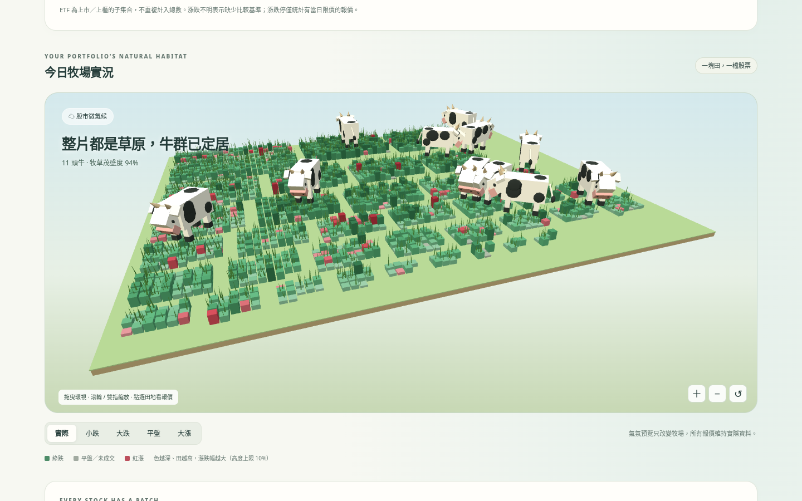
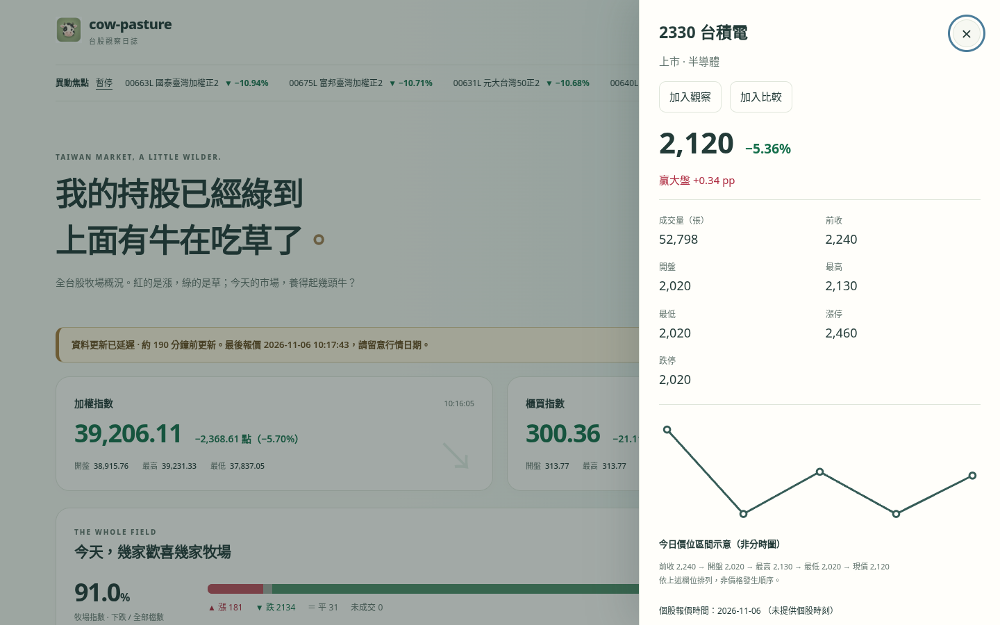

# cow-pasture

**我的持股已經綠到上面有牛在吃草了。**

臺灣習慣紅漲綠跌——這裡把綠油油的台股變成一座牧場：跌得越深，草越茂盛，牛越多。

**[打開牧場 →](https://malilion.github.io/cow-pasture/)** · 繁體中文 · 純靜態網頁





## 這是什麼

cow-pasture 是台股上市、上櫃與 ETF 的視覺化觀察站。3D 牧場依產業分區，田地顏色與高度對應漲跌；也可以用熱圖、榜單和搜尋，快速找到你關心的那一塊田。

## 你可以做什麼

- 看加權、櫃買指數與全市場漲跌家數
- 逛 3D 牧場，點一塊田打開個股明細
- 看今日盤中走勢（依定時快照累積，約 1–2 分鐘一點）
- 搜尋代號或名稱；網址 `?q=2330` 可直接打開明細
- 把股票加入本機觀察名單（只存在你的瀏覽器）
- 兩檔比較：`?cmp=2330,2454`
- 一鍵分享今日牧場卡片（SVG／PNG）
- 切換可愛／精美／成熟／獅子標誌
- 按 `?` 或頁首「鍵盤」查看快捷鍵；搜尋沒結果時可一鍵清除篩選

## 怎麼用

1. 打開 [malilion.github.io/cow-pasture](https://malilion.github.io/cow-pasture/)
2. 在搜尋框輸入代號或名稱，或從牧場／熱圖／榜單點進去
3. 明細裡可加入觀察、加入比較，或複製帶 `?q=` 的連結分享
4. 比較兩檔時用 `?cmp=代碼A,代碼B`；按 Esc 可關閉面板
5. 右上「標誌」可換牧場圖示；「分享今日牧場」可下載卡片
6. 「更新資料」會重新抓取快照；若行情沒變也會提示「資料尚未更新」

手機上明細會以全螢幕面板顯示。若裝置不支援 WebGL2，會自動改用 2D 牧場，功能仍可用。

## 資料與更新

行情來自臺灣證券交易所 MIS 與 TWSE／TPEx OpenAPI，由 GitHub Actions 在盤中約每 **1.5–2 分鐘**更新一次快照；頁面約每 **60 秒**重新讀取。資料可能延遲，**不是即時逐筆行情**。

## 聲明

本網站僅供娛樂與資訊參考，**非投資建議**。請以券商或交易所為準。

## 本機開發

需要 Node.js 20 以上，零 npm 依賴：

```sh
npm test
npm run snapshot:fixtures   # 離線樣本
npm start                   # http://localhost:5173
```

## 授權

[MIT](LICENSE) © 2026 Malilion · [開源致謝](docs/credits.html) · [原始碼](https://github.com/malilion/cow-pasture)

---

<!-- malilion-ecosystem-footer -->
<p align="center"><sub>🦁 碼力獅 <a href="https://github.com/malilion">MaliLion</a> 生態系的一員 · <a href="https://malilion.com">malilion.com</a> · <a href="https://github.com/malilion?tab=repositories">更多作品</a></sub></p>
